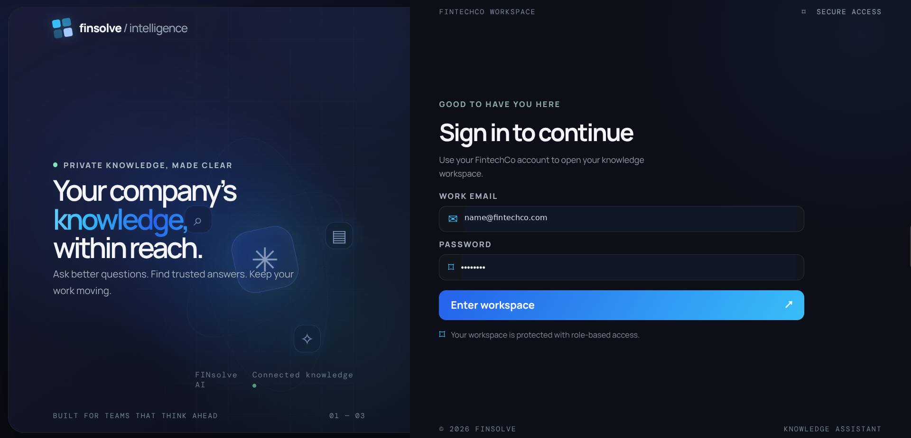
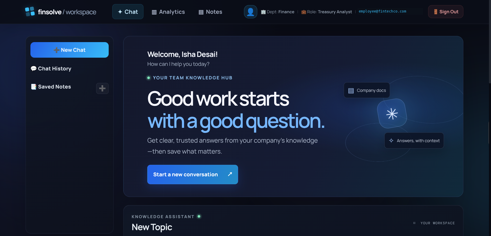
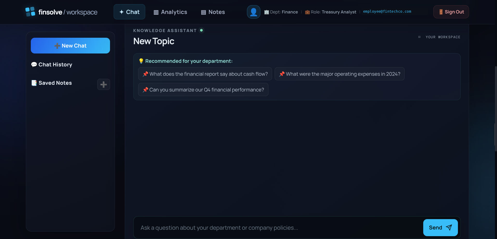
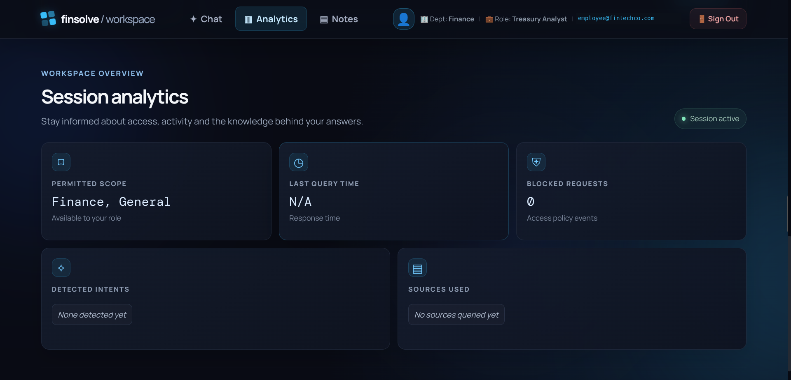

 <div align="center">

# FinSight AI

### Role-Aware Conversational RAG Assistant for Enterprise Knowledge

A retrieval-augmented generation system that enables department-specific knowledge discovery through hybrid search, conversational query understanding, access control, and structured data processing.


[Overview](#-overview) · [Architecture](#-system-architecture) · [Technical Approach](#-technical-approach) · [Evaluation](#-evaluation-results) · [Setup](#-getting-started)

</div>

---

## 📌 Overview

Enterprise knowledge is often distributed across financial reports, employee handbooks, engineering documentation, marketing reports, and structured datasets. Finding the right information requires more than a basic chatbot or a single vector search.

**FinSight AI** combines hybrid retrieval, conversational context, role-based document permissions, and deterministic data processing to answer questions using an organization's internal knowledge sources.

### The Problem

- **Retrieval inaccuracies:** Semantic search can miss exact reporting periods, identifiers, and numerical terms.
- **Access restrictions:** Different departments require different levels of document access.
- **Numerical reliability:** LLM-generated calculations over raw tabular data can produce incorrect results.
- **Conversational context:** Follow-up questions may be incomplete without the previous conversation.
- **Evaluation:** Retrieval quality and answer reliability need measurable tests rather than subjective assessment.

### The Solution

FinSight AI addresses these challenges through a modular RAG pipeline with dense and keyword retrieval, Reciprocal Rank Fusion, query rewriting, department-aware filtering, and Pandas-based processing for supported structured-data questions.

## ✨ Key Capabilities

| Capability | Implementation |
|---|---|
| Conversational question answering | Browser-based frontend |
| Semantic retrieval | ChromaDB with BGE embeddings |
| Exact-term retrieval | BM25 keyword search |
| Ranking improvement | Reciprocal Rank Fusion (RRF) |
| Follow-up questions | Conversational query rewriting |
| Department permissions | Role-based access control (RBAC) |
| Structured HR queries | Deterministic Pandas operations |
| API integration | FastAPI backend |
| Conversation management | Session-based context handling |
| Quality assurance | Retrieval evaluation and automated tests |

## ✅ Features

1. **Company employees can sign in:** the email must use `@fintechco.com` and be listed in the employee CSV.
2. **Department is checked from the CSV:** the app reads the employee's email and department from `data/hr/hr_data.csv`. It allows General, Finance, HR, Marketing, and Engineering/Technology departments.
3. **Department-based answers:** employees can ask about documents their department is allowed to see. Requests for restricted information are denied.
4. **Multiple chats:** start more than one chat, switch between them in Chat History, and continue each chat during the current browser session. A chat gets a suggested name from its first question.
5. **Multiple notes:** create, edit, and switch between notes. Note names stay separate from chat names. Chat and note data currently lasts for the current browser session.
6. **Download notes:** download the selected note as a `.txt` file.
7. **Access and answer analytics:** see the allowed document scope, response time, detected question type, and sources used.
8. **Denied-request count:** the analytics counter increases when the server denies a restricted chat request. It is a current-session count, not a permanent audit log.
9. **Answers from company files:** the assistant searches company documents and shows the sources used for its answer when available.
10. **Follow-up questions:** each chat can use its earlier messages to understand follow-up questions.

> **Demo login:** the app uses a shared demo-only password. Do not use this setup for real employee accounts or confidential data.

## 🖥️ Application Preview

The screenshots below show the sign-in page, home screen, chat, and analytics. Employee email addresses have been replaced with example addresses.

### Employee Sign-in



### Workspace Home



### Knowledge Chat



### Session Analytics



## 🏗️ System Architecture

### 1. High-Level Architecture

The system separates the frontend, API, authorization, retrieval, query processing, and response generation into distinct components.


<details>
<summary><strong>View detailed architecture diagrams</strong></summary>

### 2. Query Understanding and Routing

Shows how incoming questions are interpreted and directed to document retrieval or supported structured-data processing.


### 3. Hybrid Retrieval Pipeline

Illustrates the dense and lexical retrieval paths and the combination of their rankings.


### 4. Authentication and Authorization

Documents the authentication and role-based access-control sequence.


### 5. Document Ingestion and Indexing

Shows the document-processing and indexing pipeline used to prepare knowledge sources for retrieval.


</details>

## 🔄 How It Works

```text
Knowledge Documents
        │
        ▼
Document Loading and Chunking
        │
        ▼
Metadata Extraction and Embeddings
        │
        ▼
Local ChromaDB Index
        │
        ▼
User Question
        │
        ▼
Authentication and Permission Checks
        │
        ▼
Query Understanding and Rewriting
        │
        ├── Document-Based Questions
        │      ├── Dense Semantic Search
        │      ├── BM25 Keyword Search
        │      └── Reciprocal Rank Fusion
        │
        └── Supported Structured Questions
               └── Pandas-Based Computation
        │
        ▼
Context Preparation and Answer Generation
        │
        ▼
Response Through the Browser Frontend
```

## ⚙️ Technology Stack

| Component | Technology | Purpose |
|---|---|---|
| Programming language | Python | Application and processing logic |
| Frontend | HTML, CSS, JavaScript | Interactive chat experience |
| Backend | FastAPI, Uvicorn | API endpoints and request handling |
| LLM integration | LangChain, ChatGroq | Model interaction and generation |
| Language model | Groq-hosted model | Query processing and response generation |
| Embedding model | `BAAI/bge-small-en-v1.5` | Semantic text embeddings |
| Vector database | ChromaDB | Persistent vector storage and similarity search |
| Keyword retrieval | `rank-bm25` | Lexical matching |
| Ranking | Reciprocal Rank Fusion | Combining retrieval rankings |
| Structured processing | Pandas | Deterministic tabular calculations |
| Testing | Python `unittest` | Automated application tests |

## 🧠 Key Engineering Decisions

### Hybrid Search Instead of Vector Search Alone

Dense embeddings help retrieve conceptually related content, while BM25 helps match exact terms such as reporting periods and identifiers. RRF combines the rankings without requiring direct comparison of scores from different retrieval methods.

### Deterministic Processing for Structured Data

Supported numerical HR queries are routed to Pandas operations instead of asking the LLM to calculate results from raw CSV text. This makes supported calculations reproducible and easier to test.

### Department-Aware Retrieval

The access-control component determines the document scope permitted for each configured role. Authorization must be enforced server-side rather than relying on frontend controls alone.

### Conversational Query Rewriting

Follow-up questions can be rewritten into standalone queries using prior conversational context, helping the retriever identify the intended subject and reporting period.

### Session-Based Conversation Management

Conversation state is managed by session so that follow-up context can be associated with the appropriate user conversation. Isolation and authorization behavior should be verified through dedicated tests.

## 🔐 Department Access Model

The intended access model is summarized below. Actual permissions are determined by the application's configured authorization rules.

| Role | Intended document scope |
|---|---|
| Employee | General company information |
| Finance | General and finance documents |
| Marketing | General and marketing documents |
| HR | General and HR documents |
| Engineering | General and engineering documents |
| Executive | Cross-department information, subject to configured permissions |

Structured HR calculations should only be available to explicitly authorized roles.

**Security limitation:** This project uses demonstration authentication and authorization logic. It is not a production security solution for confidential enterprise records. Production deployment requires hardened identity management, secure credential storage, audit logging, and comprehensive authorization testing.

## 📊 Evaluation Results

The following results are from the project's recorded evaluation runs. They are specific to the evaluated dataset and test configuration.

### Retrieval Quality

| Metric | Recorded result |
|---|---:|
| Dense retrieval Recall@5 | 91.67% |
| Hybrid retrieval Recall@5 | 100.00% |
| Conversational rewriting | 5/5 |
| LLM-judge faithfulness score | 10/10 |
| LLM-judge hallucination-safety score | 10/10 |

The hybrid retrieval result represents an improvement of **8.33 percentage points** over the recorded dense-search baseline.

LLM-judge scores are evaluation-specific scores, not independently verified accuracy percentages.

### End-to-End Test Results

| Test scenario | Recorded outcome |
|---|---|
| Authorized finance question | Pass |
| Unauthorized finance-document access | Pass |
| Structured HR employee-count query | Pass |
| Handling unsupported information | Pass |
| Multi-user session isolation | Pass |

**Recorded result: 5/5 end-to-end checks passed.**

### Evaluation Scope and Limitations

These results do not establish universal retrieval accuracy, zero hallucinations, or production-grade security. For reproducibility, the evaluation should document the number of test questions, expected source documents, scoring criteria, model configuration, and the exact commands used to run each test.

## 🧩 Engineering Challenges

| Challenge | Approach |
|---|---|
| Exact reporting periods missed by semantic retrieval | Combine dense search with BM25 and RRF |
| Unreliable calculations from CSV context | Route supported numerical queries to Pandas |
| Irrelevant departmental context | Apply department-aware filtering and result deduplication |
| Incomplete follow-up questions | Rewrite queries using conversational context |
| Cross-session context risks | Maintain session-specific conversation state and test isolation |

## 📁 Repository Structure

```text
FinSight-AI/
├── app/                         # Backend and RAG runtime
│   ├── api.py
│   ├── access_control.py
│   ├── config.py
│   ├── conversation_store.py
│   ├── frontend_client.py
│   ├── generator.py
│   ├── ingestion.py
│   ├── rag.py
│   ├── retriever.py
├── frontend/
│   ├── app.js
│   ├── index.html
│   └── style.css
├── data/
│   ├── engineering/
│   ├── finance/
│   ├── general/
│   ├── hr/
│   └── marketing/
├── diagrams/
├── assets/
│   └── screenshots/
│       ├── analytics.png
│       ├── chat.png
│       ├── home.png
│       └── login.png
├── evaluation/
│   └── rag_evaluation.ipynb
├── tests/
├── requirements.txt
├── .gitignore
├── LICENSE
└── README.md
```

This tree highlights the files used by the FastAPI service and browser frontend. The repository also includes supporting data, diagrams, and tests.

## 🚀 Getting Started

### Prerequisites

- Python 3.10 or newer
- A Groq API key
- Internet access for the initial embedding-model download

### 1. Clone the Repository

```bash
git clone https://github.com/Namratapatel9027/finsight-ai.git
cd finsight-ai
```

### 2. Create and Activate a Virtual Environment

```bash
python -m venv .venv
```

Linux or macOS:

```bash
source .venv/bin/activate
```

Windows PowerShell:

```powershell
.venv\Scripts\Activate.ps1
```

### 3. Install Dependencies

```bash
python -m pip install --upgrade pip
python -m pip install -r requirements.txt
```

### 4. Configure Environment Variables

Create a `.env` file in the project root:

```dotenv
GROQ_API_KEY=your_groq_api_key
FINSOLVE_API_URL=http://127.0.0.1:8000
```

Add any additional variables required by the application's configuration, including demo authentication settings if applicable.

Never commit `.env` files, API keys, access tokens, or real employee information.

### 5. Build the Search Index

From the repository root, run:

```bash
python app/ingestion.py
```

This builds the local ChromaDB index from the supported source documents. Run ingestion again when indexed documents change.

### 6. Start the Website and API

From the repository root, run:

```bash
python -m uvicorn api:app --app-dir app --reload --port 8000
```

Open the website at <http://127.0.0.1:8000>. FastAPI serves the HTML/CSS/JavaScript frontend and its API on the same origin. The API documentation and health check are available at:

- API docs: <http://127.0.0.1:8000/docs>
- Health: <http://127.0.0.1:8000/health>

### 7. Run Automated Tests

From the repository root:

```bash
PYTHONPATH=app python -m unittest discover -s tests -v
```

Use the evaluation notebook to inspect retrieval results, compare expected documents with retrieved candidates, and investigate failures.

## 🔭 Future Improvements

- Expand the evaluation dataset and add automated regression testing.
- Benchmark a reranker against the current hybrid retrieval pipeline.
- Strengthen authentication, authorization, and audit logging.
- Improve observability with latency, error, and retrieval-quality metrics.
- Add continuous integration for tests and code quality.
- Prepare reproducible containerized deployment.
- Document model configuration, resource usage, and known limitations.

## 📄 License

See the [`LICENSE`](LICENSE) file for the project's license terms.

---

<div align="center">

**FinSight AI**

*Enterprise Knowledge Retrieval · Hybrid Search · Grounded Generation*

</div>
